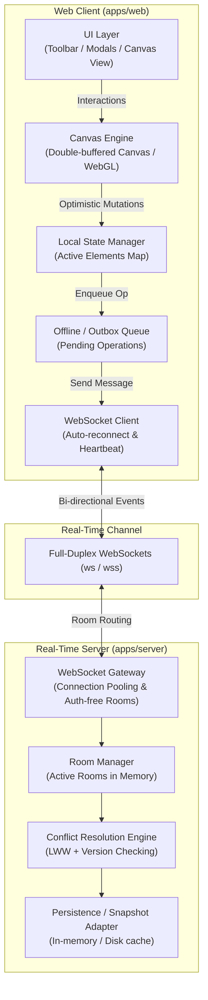
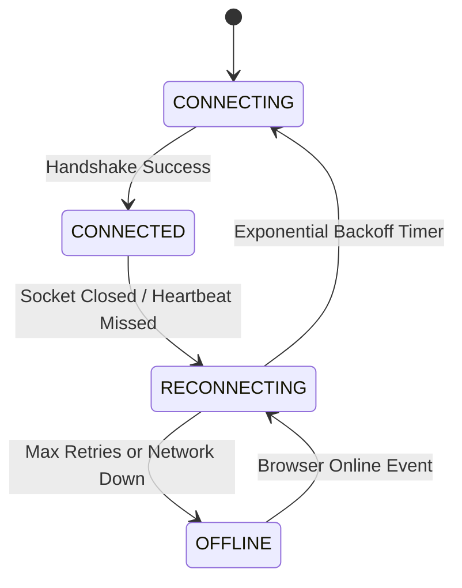

# System Architecture — Vizi

## 1. Monorepo Organization (Turborepo)

Vizi is organized as a standard Turborepo monorepo using `pnpm` workspaces. This guarantees clean boundaries, strict type sharing, and reproducible caching.

```
vizi/
├── apps/
│   ├── web/                    # Next.js (App Router), React, Tailwind, shadcn/ui
│   │   ├── app/                # Route definitions (/ and /room/[id])
│   │   ├── components/         # Canvas UI, toolbar, properties panel, modals
│   │   ├── hooks/              # useCanvas, useWebSocket, useSyncState
│   │   └── lib/                # Canvas rendering pipeline & math utilities
│   └── server/                 # Lightweight Node.js WebSocket Server
│       ├── src/
│       │   ├── room/           # Room manager & in-memory room lifecycle
│       │   ├── websocket/      # Connection handlers & router
│       │   ├── sync/           # Conflict resolution & broadcast logic
│       │   └── index.ts        # Server entrypoint
├── packages/
│   ├── protocol/               # Shared WS message types, payload schemas, events
│   ├── canvas-engine/          # Shared geometric types, bounding box & hit test math
│   ├── typescript-config/      # Shared tsconfig bases
│   └── eslint-config/          # Shared linting rules
├── .agent/                     # Agent instructions, skills, and project wiki
├── docs/                       # Long-form specifications and records
├── turbo.json                  # Turborepo task pipeline
├── pnpm-workspace.yaml         # Workspace package definitions
└── package.json                # Root package manifest
```

---

## 2. High-Level System Architecture



---

## 3. Real-Time WebSocket Protocol

All WebSocket frames transmit strictly-typed JSON messages defined in `@vizi/protocol`.

### 3.1 Message Envelope Specification

```typescript
export interface BaseMessage<TType extends string, TPayload> {
  type: TType;
  roomId: string;
  senderId: string;
  timestamp: number;
  payload: TPayload;
}
```

### 3.2 Core Event Catalog

| Event Name | Direction | Description |
| :--- | :--- | :--- |
| `room:join` | Client $\to$ Server | Client requests to join a room with their ephemeral profile (name, color). |
| `room:joined` | Server $\to$ Client | Server returns current room snapshot (elements, active peers). |
| `presence:cursor` | Client $\rightleftharpoons$ Server | Ephemeral cursor coordinates `(x, y)` for multiplayer pointers (throttled). |
| `element:create` | Client $\rightleftharpoons$ Server | Creation of one or more canvas elements. |
| `element:update` | Client $\rightleftharpoons$ Server | Mutation of existing elements (drag, resize, color, text). |
| `element:delete` | Client $\rightleftharpoons$ Server | Soft-deletion / tombstoning of element IDs. |
| `sync:request` | Client $\to$ Server | Request missing mutations after recovering from disconnection. |
| `heartbeat:ping` | Client $\rightleftharpoons$ Server | Keep-alive ping/pong frames every 5 seconds. |

---

## 4. State Synchronization & Conflict Resolution (LWW)

### 4.1 Last-Write-Wins (LWW) with Monotonic Versioning
To achieve near-zero latency without heavyweight CRDT operational overhead, Vizi employs **Element-Level Last-Write-Wins (LWW)** backed by version numbers and timestamps:

1. **Local Optimistic Mutation**:
   - The user draws or edits a shape.
   - The local element is immediately updated in memory.
   - The client increments `element.version += 1` and sets `element.updatedAt = Date.now()`.
2. **Server Ingestion & Reconciliation**:
   - The server inspects incoming `element:update`.
   - If `incoming.version > current.version` OR (`incoming.version === current.version` AND `incoming.updatedAt > current.updatedAt`), the change is accepted and persisted.
   - If accepted, the server broadcasts the accepted state to all other peers in the room.
3. **Idempotency & Deduplication**:
   - Every mutation payload contains an `opId: string` (UUID).
   - If an operation is received twice (e.g., due to network replay), the duplicate is dropped silently.
4. **Tombstone Deletion**:
   - Deleted elements are marked with `isDeleted: true` and retained for a grace period. This prevents an out-of-order delayed update from resurrecting an element that was previously deleted.

---

## 5. Fault Tolerance & Network Resilience

### 5.1 Connection State Machine


### 5.2 Resilient Reconnection Flow
1. **Heartbeat Failure Detection**:
   - Client and server exchange `ping` / `pong` frames every 5s.
   - If no reply is received within 3s, the socket is immediately terminated and reconnection begins.
2. **Exponential Backoff with Jitter**:
   - Retry intervals: $500\text{ms} \to 1000\text{ms} \to 2000\text{ms} \to 4000\text{ms}$ (capped at 10s) with $\pm 20\%$ randomized jitter to prevent thundering herds.
3. **Offline Outbox Mutation Queue**:
   - When disconnected, client drawing operations are written to an in-memory `mutationQueue`.
   - The user continues drawing uninterrupted.
   - Upon reconnection, the client sends `sync:request` with its `lastKnownServerVersion`, flushes its pending `mutationQueue`, and reconciles incoming server state.

---

## 6. Guidelines for AI Coding Agents

When implementing features or modifying existing code in this repository:

1. **Type Locations**:
   - All shared data models, element schemas, and WS message types **must** live in `packages/protocol` or `packages/canvas-engine`.
   - Never redefine canvas elements or message envelopes locally inside `apps/web` or `apps/server`.
2. **Canvas Render Loop Separation**:
   - Keep the rendering loop independent from React's component re-render lifecycle. Use `requestAnimationFrame` and an explicit canvas renderer class/function to prevent React render thrashing during high-frequency drags.
3. **Validate External Boundaries**:
   - Always validate WebSocket payloads at the server gateway before modifying the room state.
4. **No Auth Logic**:
   - Do not introduce user tables, JWT tokens, cookies, or authentication middleware. The application is strictly link-based and anonymous.
5. **Preserve Documentation Integrity**:
   - If an architecture decision or data structure changes, update both this wiki and the files in `docs/`.
